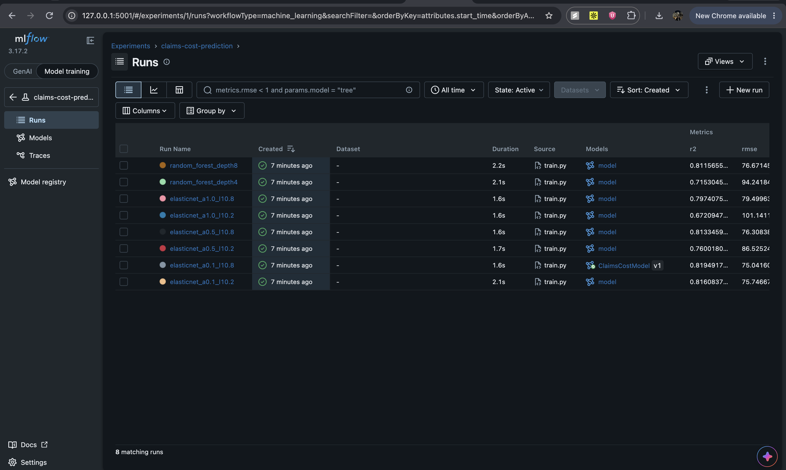

# Lab 3: Experiment tracking with MLflow

Based on `Experiment_Tracking_Labs/Mlflow_Labs/Lab1`. The course lab trains one ElasticNet model on the wine-quality dataset and logs it with MLflow. I changed it to compare several models on a problem closer to our final project, and to use the Model Registry to pick and load the best one.

## The problem

Predict an employer group's claims cost per member per month (PMPM) from the group's average age, share of female members, group size, share of members with a chronic condition, plan type (bronze/silver/gold) and region. The data is synthetic (2,000 groups, generated in `src/data.py`), so there's no real or private data. I made cost rise faster with age and multiply by plan and region, so it isn't purely linear.

## What I changed from the course lab

**More than one run.** `train.py` trains 8 models: ElasticNet with every combination of `alpha` (0.1, 0.5, 1.0) and `l1_ratio` (0.2, 0.8), and a random forest with depth 4 and depth 8. Each one is its own MLflow run with its parameters, RMSE/MAE/R², a `model_family` tag, and a predicted-vs-actual plot.

**Scaling for ElasticNet.** The course lab feeds raw features into ElasticNet. Here the features are on very different scales (age around 40, group size up to 1,000, chronic rate around 0.15), and ElasticNet's penalty treats all coefficients the same, so I put a `StandardScaler` in front of it in a pipeline.

**Model Registry.** The course lab skips registration because the default file store doesn't support it. I point MLflow at a SQLite database (`sqlite:///mlflow.db`), so after all runs finish, the lowest-RMSE model gets registered as `ClaimsCostModel` and tagged with the alias `champion`.

**Loading by name instead of by path.** The course lab loads a model from a hard-coded `mlruns/0/<run id>/...` path. `predict.py` loads `models:/ClaimsCostModel@champion` instead, so it always gets whichever model is currently the champion, with no IDs to copy.

## How to run

```bash
cd lab3
bash run_lab.sh
```

To look at the runs in the MLflow UI afterwards:

```bash
source lab_03/bin/activate
mlflow ui --backend-store-uri sqlite:///mlflow.db --port 5001
```

Then open http://127.0.0.1:5001 and select the `claims-cost-prediction` experiment.

## Files

```
lab3/
├── src/
│   ├── data.py      # generates the synthetic dataset
│   ├── train.py     # 8 runs + registers the best model
│   └── predict.py   # loads the champion model and scores 5 new groups
├── results/         # experiment_results.csv and sample_predictions.csv (written by the scripts)
├── run_lab.sh
└── requirements.txt
```

## Results

Test-set results from my run, sorted by RMSE (full table in `results/experiment_results.csv`):

| Run | RMSE | R² |
|---|---|---|
| elasticnet_a0.1_l10.8 | 75.04 | 0.8195 |
| elasticnet_a0.1_l10.2 | 75.75 | 0.8161 |
| elasticnet_a0.5_l10.8 | 76.31 | 0.8133 |
| random_forest_depth8 | 76.67 | 0.8116 |
| elasticnet_a1.0_l10.8 | 79.50 | 0.7974 |
| elasticnet_a0.5_l10.2 | 86.53 | 0.7600 |
| random_forest_depth4 | 94.24 | 0.7153 |
| elasticnet_a1.0_l10.2 | 101.14 | 0.6721 |

I expected the random forest to win because the data has non-linear parts, but the best ElasticNet (with scaling and a small `alpha`) came out slightly ahead of the depth-8 forest. The depth-4 forest was too shallow and did much worse. For ElasticNet, a bigger `alpha` (stronger penalty) consistently hurt, especially with a low `l1_ratio`.

## A problem I ran into

The first time I ran it, the ElasticNet runs logged fine but the random forest crashed at `log_model`. Newer MLflow versions save scikit-learn models with skops, which refuses to save tree objects (`sklearn.tree._tree.Tree`) unless you mark them as trusted, because a tampered tree file could crash the program when loaded. Since I trained the model myself, I pass `skops_trusted_types=["sklearn.tree._tree.Tree"]` for the random forest runs only.

## MLflow UI

The 8 runs in the MLflow UI. The best run has the registered `ClaimsCostModel v1` next to it:


